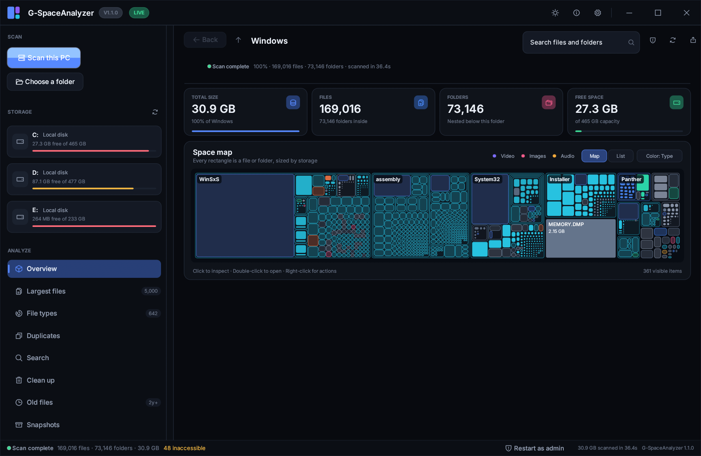

# G-SpaceAnalyzer

[](https://github.com/DakaGoa/G-SpaceAnalyzer/actions/workflows/release.yml)

A fast, modern, free and open source disk space analyzer for Windows, written in Rust.

G-SpaceAnalyzer shows where the space on a drive actually went, then lets you do something
about it: browse a space map, sort the biggest files, find duplicates, clear caches, spot
data that has not been touched in years, and compare two saved scans to see what grew.

No account, no licence key, no telemetry, no network access — everything is measured on your
own PC.



## Features

- **Space map** — treemap of any folder, coloured by file type, age or folder, with zoom and a
  size-ordered list view
- **Largest files** — sortable table with instant path inspection and filtering
- **File types** — space and count per extension and category
- **Duplicates** — content-verified identical files, single or bulk removal
- **Search** — name search across the whole scan
- **Clean up** — temp folders, browser caches and Windows Update leftovers, measured then cleared
- **Old files** — files untouched for 1, 2, 3, 5 or 10 years
- **Snapshots** — save a scan and diff it against the current one; the compact option stores
  folder totals only and takes a fraction of the disk space
- **Everywhere** — right-click any file or folder to open it, open its location, copy its path
  or delete it (Recycle Bin by default, optionally permanent)
- **Also on the command line** — `G-SpaceAnalyzer --scan C:\ --export report.csv` runs the same
  scan headless

## Install

**[Download the latest release](https://github.com/DakaGoa/G-SpaceAnalyzer/releases/latest)** and
run `GSpaceAnalyzerSetup.exe` — or use the direct link:
<https://github.com/DakaGoa/G-SpaceAnalyzer/releases/latest/download/GSpaceAnalyzerSetup.exe>

It installs per user into `%LOCALAPPDATA%\Programs\G-SpaceAnalyzer` (no administrator rights, no
UAC prompt), adds a Start menu shortcut and registers with Add or Remove Programs. Upgrades install
over the top and keep your settings and snapshots, and the same setup file can be used to uninstall.

Silent install: `GSpaceAnalyzerSetup.exe /S`

## Build

Requires a recent stable Rust toolchain on Windows.

```
cargo build --release
```

The binary lands at `target\release\G-SpaceAnalyzer.exe`.

To build the installer as well:

```
powershell -ExecutionPolicy Bypass -File installer\build-installer.ps1
```

The installer is built with the C# compiler that ships with .NET Framework, so no extra tooling
is needed, and the result is a single self-contained `dist\GSpaceAnalyzerSetup.exe`.

### Code signing

Builds are unsigned by default, which is why Windows shows a SmartScreen warning and why Defender's
heuristics sometimes flag a fresh download.

Releases are signed for free through [SignPath Foundation](https://signpath.org/), which signs
open-source Windows builds with a certificate issued to the foundation: the private key stays on
their HSM and the signing request is bound to a GitHub Actions run of this repository. The workflow
is ready for it — it needs one repository secret and one variable, both created in the SignPath
account set up per [CODE_SIGNING.md](CODE_SIGNING.md): `SIGNPATH_API_TOKEN` and
`SIGNPATH_ORGANIZATION_ID`. Until they exist, releases are built and published unsigned and the log
says so.

If you have your own certificate instead, `installer/build-installer.ps1` signs with it directly —
`signtool` (from the Windows SDK) is found automatically:

```
$env:CODESIGN_PFX = 'C:\certs\codesign.pfx'
$env:CODESIGN_PFX_PASSWORD = 'the-password'
powershell -ExecutionPolicy Bypass -File installer\build-installer.ps1
```

The app executable is signed before it is embedded into the setup, then the setup is signed and
verified. Releases built by the GitHub workflow do the same once two repository secrets exist:
`CODESIGN_PFX` (base64 of the `.pfx`, made with
`[Convert]::ToBase64String([IO.File]::ReadAllBytes('cert.pfx'))`) and `CODESIGN_PFX_PASSWORD`.

## Tests

```
cargo test
```

## Licence

MIT — see [LICENSE](LICENSE).
